<div align="center">


# Sellekni · سلّكني

**After a road crash, the phone raises the alert, and the rescuers receive information they can use.**

Crash detection on the phone → one 160-character packet over the internet *or plain SMS* → an explainable estimated risk,<br>
duplicate reports merged, hospital suggestions → **humans decide** in the operations room and at the hospital.

[](https://github.com/Ben-coderr/solvex-hack/actions/workflows/ci.yml)


**Team Tassili AI** · Cheikh Mohamed Tahar · Benkorich Abdenour · Ould Miloud Zakaria · Bouzid Mustapha · Baghdad Imad Eddine

[What it does](#what-it-does) · [Screens](#screens) · [How it works](#how-it-works) · [Quick start](#quick-start) · [Repository map](#repository-map) · [Docs](docs/README.md)

</div>

> [!IMPORTANT]
> A hackathon prototype on **synthetic data**, not an official emergency service and not a dispatch system.
> The score is an **estimated risk, not a diagnosis**: it comes from written rules, not AI, and a person always decides.
> The real emergency call still happens: **14 / 1021 · 1055 · 17**.

---

## What it does

<p align="center">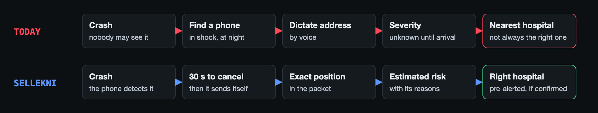</p>

| | Who | What they get |
|---|---|---|
| 🚗 | **Driver** (Android app) | *Drive mode* arms itself above 25 km/h. After a crash there is a 30 s countdown ("I'm OK" cancels it), then an alert goes out over HTTPS, or by SMS when there is no data. There is also a 1.5 s **SOS** hold button. |
| 👀 | **Witness** | Reports in **5 taps in the app** or with **4 questions on a web link**, with no account and no name. The phone adds the position. |
| 🖥️ | **Operations room** (web) | Live map and queue, a triage marker with an **estimated risk and its 3 reasons**, merged duplicate reports, a lifecycle bar, ranked hospitals with routes, a one-click pre-alert and an audit log of every human decision. |
| 🏥 | **Hospital ED** (web + SMS) | An incoming-patient card with mechanism, vitals and an arrival countdown. One click acknowledges it, and status can be set to *Available / Busy / Saturated*. |
| 🚑 | **Ambulance crew** (web link) | Sends on-scene updates (GCS, systolic BP, SpO₂) that re-score the incident. |

Everything is in **Arabic (RTL), French and English**, with light and dark themes.

## Screens

### Phone app (Expo / React Native, Android)

<p align="center"></p>
<p align="center"><sub>Home · Drive mode · Witness in the app (step 1 of 5) · Witness web link (no install). Taken on a real phone with the demo banner on.</sub></p>

### Operations room and hospital (Next.js)

<table>
<tr>
<td width="50%">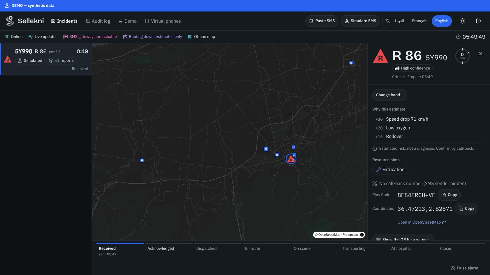<br><sub><b>Dispatcher.</b> A red ▲ R 86 pin, high confidence, <i>why this estimate</i> (+30 speed drop, +20 low oxygen, +15 rollover) and the disclaimer.</sub></td>
<td width="50%">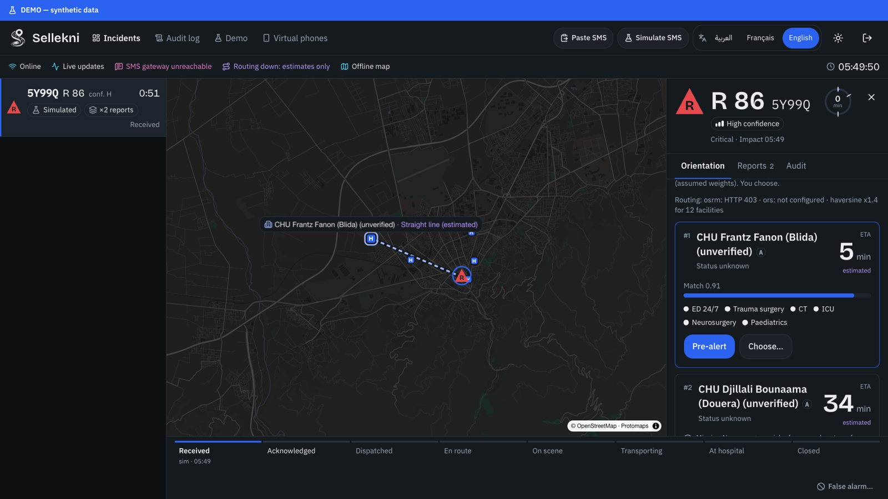<br><sub><b>Orientation.</b> Hospitals ranked by time, capabilities, load and level, with the route drawn. The dispatcher chooses.</sub></td>
</tr>
<tr>
<td>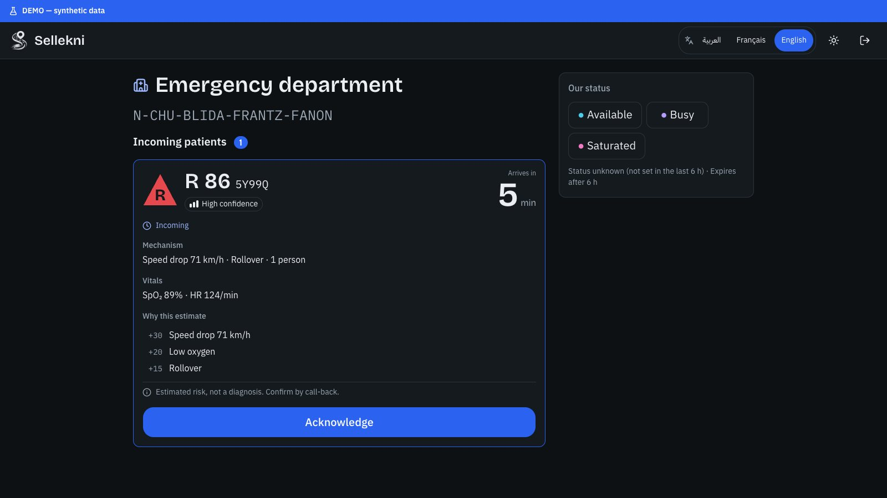<br><sub><b>Hospital ED.</b> Pre-alert card with mechanism, vitals, reasons and ETA. One button to acknowledge.</sub></td>
<td>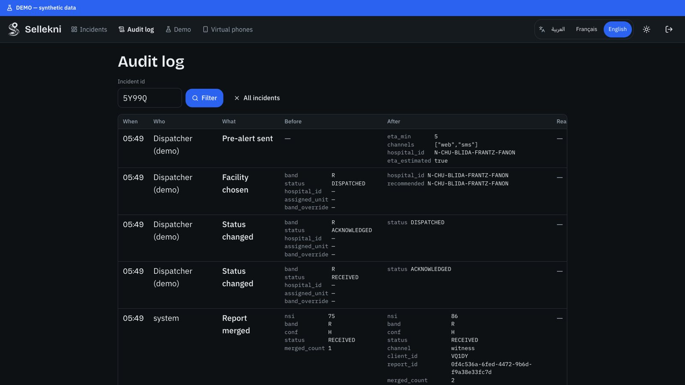<br><sub><b>Audit log.</b> Each step records who, what, before, after and when.</sub></td>
</tr>
</table>

<details>
<summary><b>More screens</b>: demo control and the driver phone's packet view</summary>

<p align="center">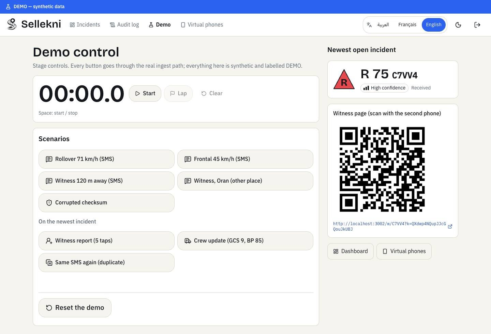</p>
<p align="center">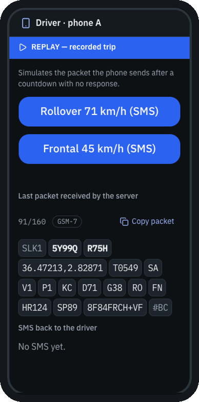</p>

Full responsive sets (360 / 768 / 1440 px, ar / en / fr, light / dark): [`docs/pitch/design/`](docs/pitch/design/).
Recorded demo clips: [`docs/pitch/videos/`](docs/pitch/videos/).
</details>

## How it works

<p align="center">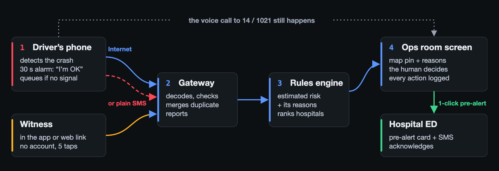</p>

1. **Detect.** The phone's detector arms above 25 km/h and needs four gates before it alerts (below).
2. **Send one packet.** It is ≤ 160 GSM-7 characters and goes over HTTPS when there is data, or as a plain SMS to a gateway phone when there isn't. The bytes are the same either way and are queued offline.
3. **Decode and assess** on the server, which is authoritative. CRC check, *Sellekni Severity Index* (rules, every point explained), confidence.
4. **Merge.** Reports within **300 m and 10 min** become one incident, and each independent report raises the confidence.
5. **Rank hospitals.** Score = time, capabilities, load and level. The dispatcher picks, and the hospital gets a web card and an SMS pre-alert.

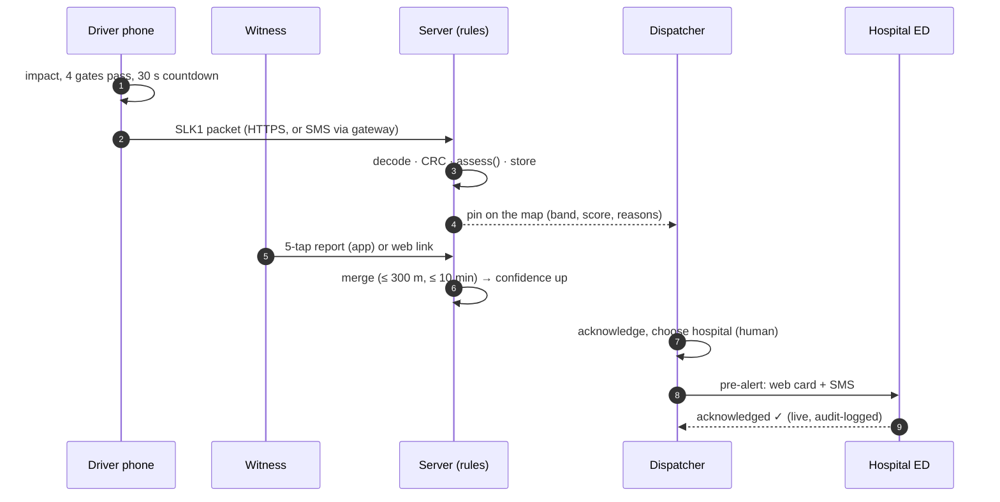

<details>
<summary><b>Full reference diagrams</b>: system architecture, hero flow, detector state machine, sources → packet</summary>

| | |
|---|---|
| 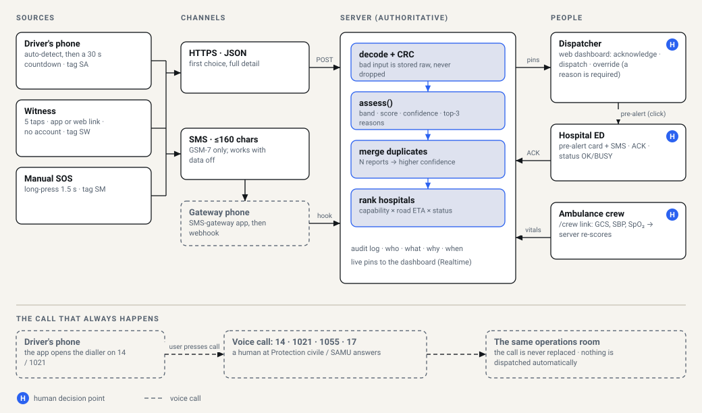 | 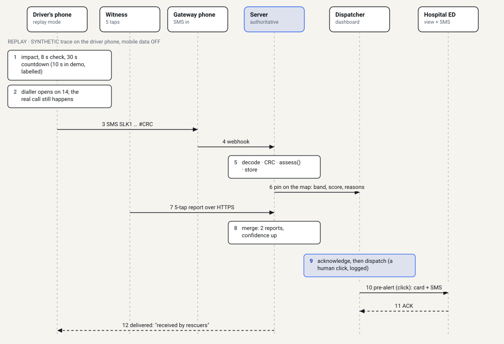 |
| 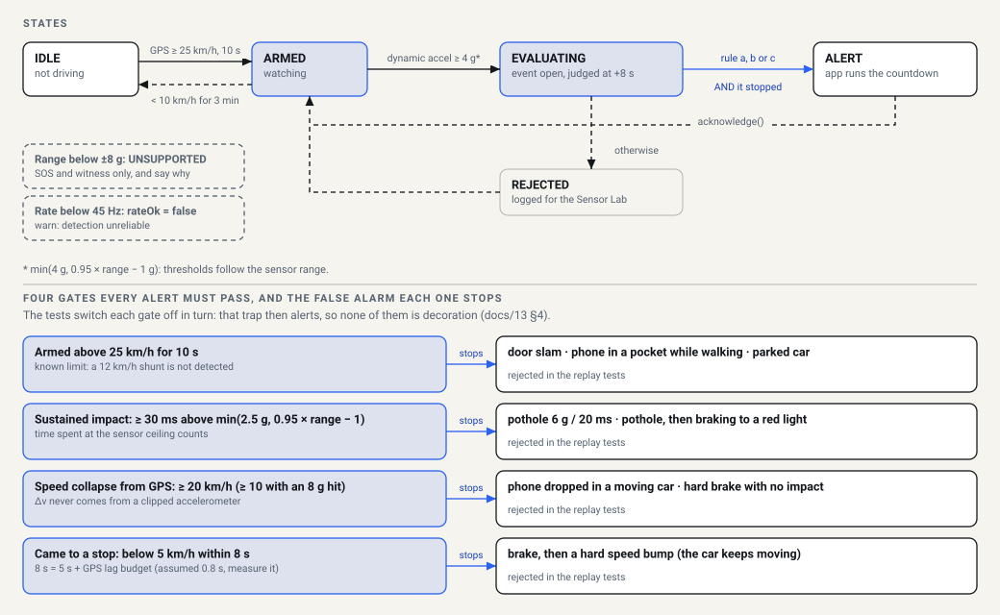 | 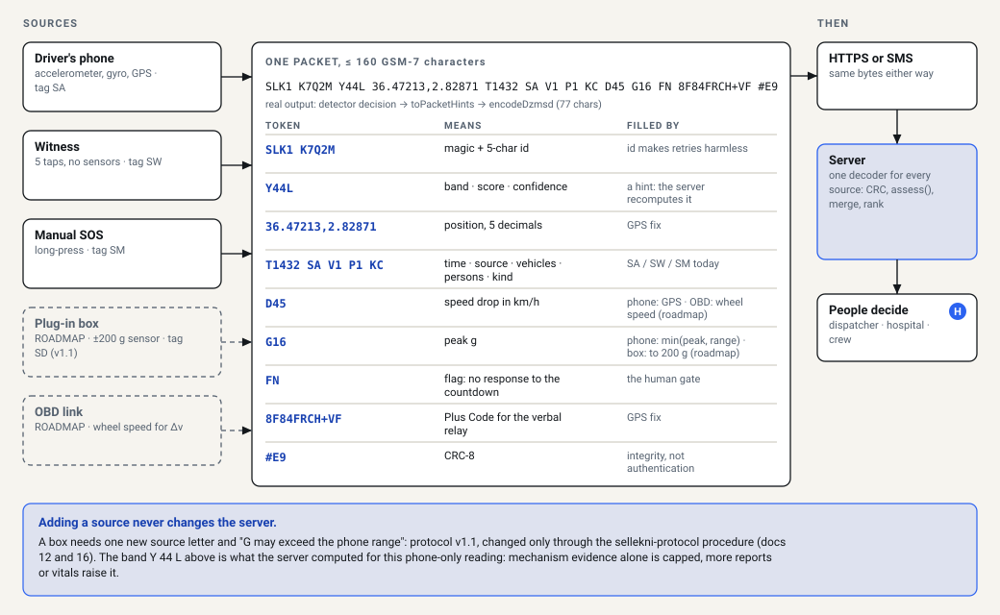 |

Generated by [`docs/diagrams/build_diagrams.py`](docs/diagrams/build_diagrams.py). One-page blueprint: [`docs/diagrams/sellekni-blueprint.html`](docs/diagrams/sellekni-blueprint.html).
</details>

### Crash detection: four gates, no single spike

<p align="center">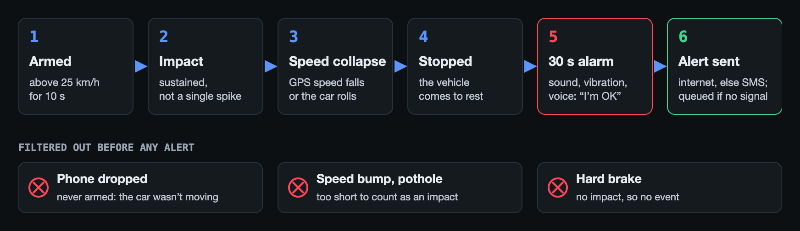</p>

The detector is pure TypeScript in [`packages/detector`](packages/detector). The same code runs on the phone and in tests.
It has only been validated on **synthetic and replayed traces**, so no real-road detection rate is claimed ([docs/13](docs/13-PHONE-SENSING-PLAN.md)).

### One packet, 160 characters, works without internet

<p align="center">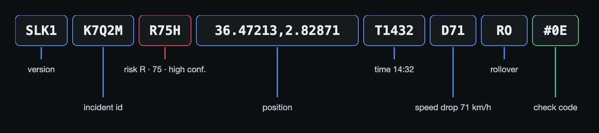</p>

```text
SLK1 K7Q2M R75H 36.47213,2.82871 T1432 SA V1 P1 KC D71 G38 RO FN HR124 SP89 8F84FRCH+VF #0E
│    │     │    │                │     │  │  │  │  │   │   │  │  │     │    │           │
│    │     │    │                │     │  │  │  │  │   │   │  │  │     │    │           └ CRC-8
│    │     │    │                │     │  │  │  │  │   │   │  │  │     │    └ Plus Code (verbal relay)
│    │     │    │                │     │  │  │  │  │   │   │  │  │     └ SpO₂
│    │     │    │                │     │  │  │  │  │   │   │  │  └ heart rate
│    │     │    │                │     │  │  │  │  │   │   │  └ flag: no response
│    │     │    │                │     │  │  │  │  │   │   └ rollover
│    │     │    │                │     │  │  │  │  │   └ peak g
│    │     │    │                │     │  │  │  │  └ speed drop, km/h
│    │     │    │                │     │  │  │  └ kinds: car
│    │     │    │                │     │  │  └ persons
│    │     │    │                │     │  └ vehicles
│    │     │    │                │     └ source: A auto · W witness · M manual SOS
│    │     │    │                └ time hh:mm
│    │     │    └ lat, lon
│    │     └ phone's hint: band R, score 75, confidence H (the server recomputes it)
│    └ incident id (Crockford base32)
└ protocol magic
```

The full grammar and test vectors are in [docs/05](docs/05-PROTOCOL-SCORING-RANKING.md) and [`packages/shared/test-vectors/`](packages/shared/test-vectors). A Python decoder cross-checks the TypeScript one in CI.

### Estimated risk, hospital ranking, merge rule

| Rule | What it says | Where |
|---|---|---|
| **Severity index** | Physiology can force band **R**. Mechanism alone is capped at **O**. Every point carries a reason. *All weights are assumptions awaiting clinical calibration.* | [`scoring.ts`](packages/shared/src/scoring.ts) |
| **Hospital ranking** | `S = 0.45·time + 0.35·capabilities + 0.15·load + 0.05·level`. Statuses expire to *unknown* after 6 h. | [`ranking.ts`](packages/shared/src/ranking.ts) |
| **Merge** | Same id, **or** ≤ 300 m **and** ≤ 10 min apart → one incident. Each independent report raises confidence. | [`merge.ts`](packages/shared/src/merge.ts) |

<p align="center">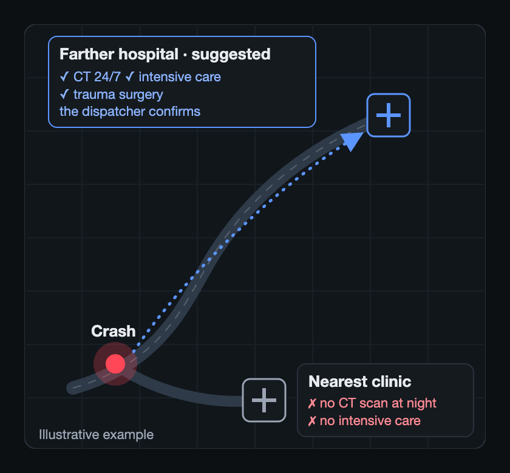</p>

### Incident lifecycle

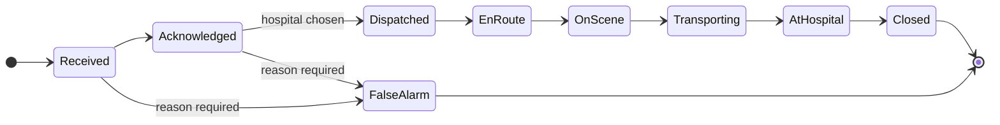

Overriding the band or the suggested hospital needs a written reason, and each change goes into the audit log.

## Free app today, hardware on the roadmap

<picture>
  <source media="(prefers-color-scheme: dark)" srcset="docs/assets/diagrams/hw-tiers-dark.png">
  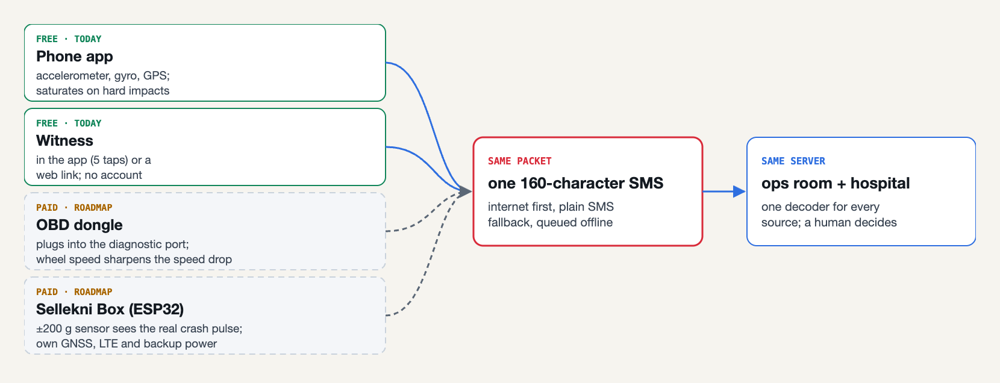
</picture>

<details>
<summary><b>Roadmap hardware</b> (not built): OBD dongle and the Sellekni box</summary>

<picture>
  <source media="(prefers-color-scheme: dark)" srcset="docs/assets/diagrams/hw-obd-dark.png">
  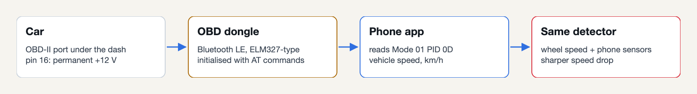
</picture>
<picture>
  <source media="(prefers-color-scheme: dark)" srcset="docs/assets/diagrams/hw-box-dark.png">
  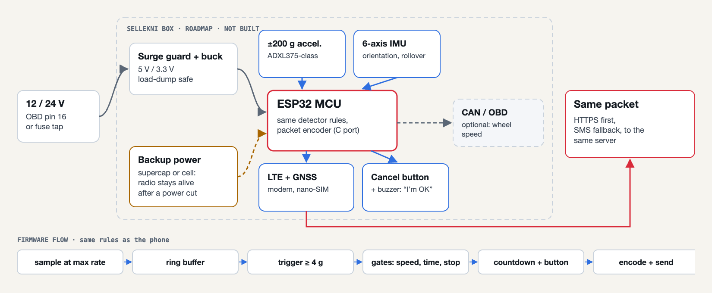
</picture>

Details are in [docs/12](docs/12-DECISIONS-REBRAND-OBD-IOT.md) and [docs/16](docs/16-ROADMAP-OBD-AND-BOX-REFERENCE.md). A new source never changes the server: it sends the same packet.
</details>

**Business Model Canvas:** [one page (PDF)](docs/pitch/bmc/) · [diagram](docs/diagrams/06-bmc.svg) · [docs/14](docs/14-BUSINESS-MODEL-CANVAS.md). Every price and partner in it is a hypothesis to validate.

## Quick start

**Prerequisites:** Node 22+, `corepack enable` (pnpm), Docker Desktop or colima, the Supabase CLI, and Google Chrome.

```bash
pnpm install
./sellekni open --reset  # everything: Docker → Supabase → logins → production build → USB phones → ready check → signed-in Chrome
./sellekni test          # unit tests, typecheck, protocol cross-check, end-to-end hero flow
```

Then follow the **90-second hero flow** in [docs/RUNNING.md](docs/RUNNING.md#3-test-the-hero-flow--90-s). That file also covers the accounts, every `./sellekni` command, what is simulated and troubleshooting.

<details>
<summary><b>Phone app</b> (Android release APK)</summary>

```bash
cd apps/mobile/android && ./gradlew assembleRelease     # → app/build/outputs/apk/release/app-release.apk
adb install -r app/build/outputs/apk/release/app-release.apk
adb reverse tcp:3000 tcp:3000                           # phone → laptop over USB; server URL http://127.0.0.1:3000
```

The server URL and the SMS gateway number are set in the app's **Settings**. Development builds use `./sellekni up --mobile`, not Expo Go, because of the native SMS module.
</details>

## Repository map

```text
.
├── apps/
│   ├── web/                 Next.js 16: dispatcher, hospital, audit, witness /w, crew, demo · API routes · Playwright e2e
│   └── mobile/              Expo / React Native: drive mode, countdown, SOS, witness, outbox, native SMS module (Kotlin)
├── packages/
│   ├── shared/              the protocol: DZ-MSD packet, CRC-8, GSM-7, Plus Code, scoring, ranking, merge + test vectors
│   ├── detector/            crash detector state machine, synthetic traces, replay
│   ├── api-contract/        zod schemas for the JSON channel (phone ↔ API ↔ pages)
│   ├── ui-core/             display logic shared by web and mobile (triage shapes, packet view), no React
│   └── tokens/              design tokens → CSS variables + RN theme, with a WCAG contrast test
├── supabase/                migrations, seed, local config
├── data/                    hospital sets (synthetic demo + unverified national OSM), demo DB snapshot, sensor traces
├── scripts/                 env setup, seeding, curl demo, reset between demo runs
├── docs/
│   ├── 03–17 *.md           numbered specs: product, architecture, protocol, design, plan, pitch, risks…
│   ├── RUNNING.md           run and test it locally (accounts, commands, troubleshooting)
│   ├── diagrams/            reference SVGs (+ pitch/ sources: gen.py, hw.py)
│   ├── assets/              README images: brand/, screenshots/, diagrams/
│   ├── guidelines/          design constitution, medical language, protocol guard
│   ├── field-notes/         drills and measurements
│   └── pitch/               deck material, BMC, runbook, Q&A sheet, videos, screenshot sets
├── DEVELOPMENT.md           hard rules, conventions, "things that bit us"
├── DECISIONS.md             decision log
└── sellekni                 one-command runner (up / open / test / reset / down)
```

Each app and package has its own `README.md`.

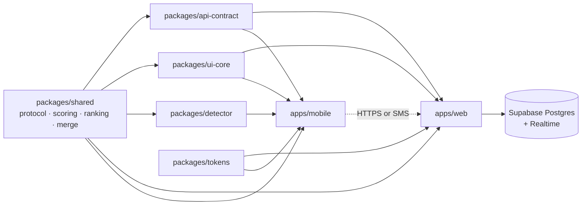

## Tech stack

| Layer | Choice |
|---|---|
| Web | Next.js 16 (App Router), React, Tailwind, shadcn/ui, MapLibre GL (OpenFreeMap tiles, or an offline `.pmtiles`) |
| Server data | Supabase local stack: Postgres, Auth, Realtime (`postgres_changes`), plus a 15 s polling fallback |
| Phone | Expo / React Native, an `expo-sqlite` outbox, and a custom Expo module (Kotlin) that sends SMS directly |
| Protocol | TypeScript in `packages/shared`, cross-checked by an independent Python decoder (`pnpm crosscheck`) |
| Tests | Unit tests per package, a token contrast test, DB tests, and Playwright end-to-end on a production build |
| CI | GitHub Actions: shared tests + typecheck + contrast + cross-check, web build, lint, mobile typecheck |

## Honesty notes

- **Synthetic data only.** Demo incidents (K7Q2M, P3N8D…) and the demo hospitals are invented. The national hospital set comes from OpenStreetMap, and its capabilities are **unverified**. Real hospital phone numbers are never used.
- **No invented metrics.** Detection has only been tested on synthetic or replayed traces. Field measurements go in [`docs/field-notes/`](docs/field-notes/) once the team has run them.
- **Medical language:** "estimated risk, not a diagnosis", weights are assumptions, and a person decides each step ([guideline](docs/guidelines/medical-language.md)).
- Simulated parts are labelled on screen: the SMS gateway in sim mode, straight-line ETAs without OSRM, online map tiles, and the DEMO banner.

## Documentation

Start at **[docs/README.md](docs/README.md)**. It maps the numbered specs (product, architecture, protocol, design, deployment, pitch, risks, sensing, BMC), the guidelines and the pitch material. Before you change code, read [`DEVELOPMENT.md`](DEVELOPMENT.md). Before you change the protocol, read [protocol guard](docs/guidelines/protocol-guard.md).

<div align="center"><sub>Built for SolveX 3.0 by <b>Team Tassili AI</b>.</sub></div>
