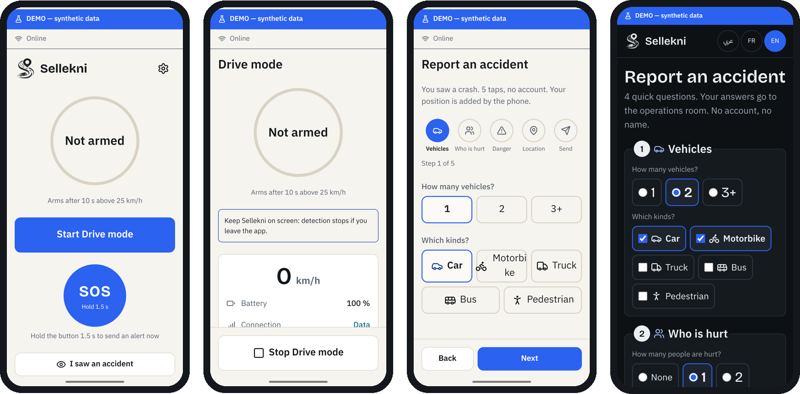

# mobile: Sellekni phone app (Expo / React Native, Android)

The driver's phone detects a crash and sends the alert, and a witness can report one in 5 taps. **Synthetic data only.**
The overview with screenshots is in the [root README](../../README.md). Project rules are in [`DEVELOPMENT.md`](../../DEVELOPMENT.md).

<p align="center"></p>

## Screens (`app/`, expo-router)

| Route | Screen |
|---|---|
| `onboarding/` | language → 3 explain pages → permissions (location, SMS, notifications) |
| `index.tsx` | Home: readiness ring, **Start Drive mode**, **SOS** (hold 1.5 s), *I saw an accident* |
| `drive.tsx` | Drive mode: arms after 10 s above 25 km/h, live speed, battery, connection |
| `countdown.tsx` | 30 s alarm + voice ("I'm OK" cancels); then the alert leaves |
| `alert/[id].tsx` | Alert status: channel rows (HTTPS, SMS GW1/GW2, contacts), server ACK, estimated risk |
| `witness.tsx` | In-app witness report: vehicles → who is hurt → danger → location → send (no account) |
| `settings.tsx` | Server URL and key, SMS gateway numbers (GW1/GW2), emergency contacts, countdown length, language, alarm test, links to replay and Sensor Lab |
| `replay.tsx`, `sensor-lab.tsx`, `styleguide.tsx` | Demo replay of recorded trips, sensor recording (M9), UI kit |

## Code (`src/`)

| Folder | What lives there |
|---|---|
| `detector/` | Adapter from phone sensors to [`@sellekni/detector`](../../packages/detector) + GPS speed |
| `alert/` | Packet building, the HTTPS→SMS fallback chain, the persistent outbox, witness reports |
| `channels/` | Native SMS (`modules/sellekni-native`, Kotlin `SmsManager`) and the composer fallback |
| `services/` | Drive session, alarm/voice, connectivity, SQLite outbox, witness location |
| `state/` | Session and settings stores (saved settings survive app updates) |
| `ui/`, `components/` | Design system on [`@sellekni/tokens`](../../packages/tokens): triage marker, rings, SOS button, packet view |
| `i18n/` | `ar` (RTL), `fr`, `en` |

## Build and run

```bash
# release APK (sideloaded: SEND_SMS is Play-restricted)
cd android && ./gradlew assembleRelease
adb install -r app/build/outputs/apk/release/app-release.apk
adb reverse tcp:3000 tcp:3000      # then Settings → server URL http://127.0.0.1:3000

# development build with Metro (not Expo Go: the native SMS module needs a dev build)
./sellekni up --mobile             # from the repo root
```

`EXPO_PUBLIC_SELLEKNI_SERVER_URL` sets the default server URL at build time. A value saved in Settings takes precedence.

## Tests

```bash
pnpm --filter mobile test          # alert chain, outbox, replay, sensor lab, speed (node --test via tsx)
pnpm --filter mobile typecheck
pnpm --filter mobile traces        # re-bundle the synthetic replay traces from packages/detector
```
